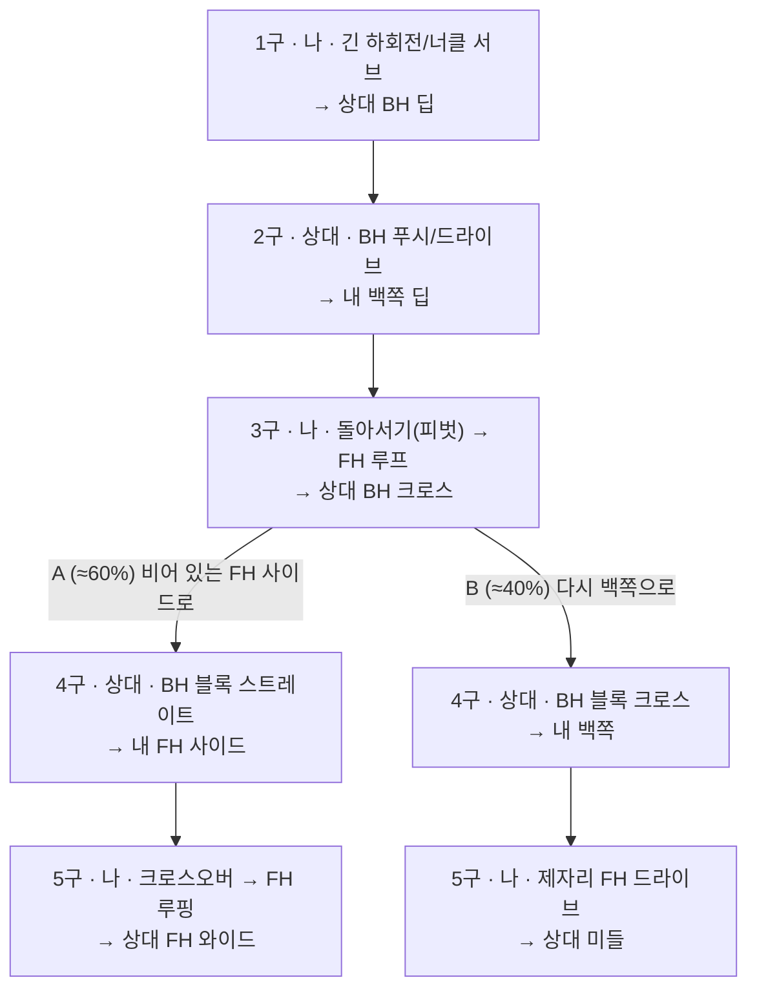

# TT Tactics 설계 문서 (v0.1)

탁구 전략을 **시각적으로 그려 보여주고, 구(球)마다 왜 그렇게 치는지 설명하는 앱**.

출발점이 된 패턴:

> 서브 후 3구 공격. 긴 하회전/너클 서브 → 백쪽으로 돌아오는 공을 돌아서서(피벗) 포핸드로 치고,
> 상대가 포핸드 사이드로 리턴하면 스텝으로 따라가서 포핸드 루핑.

이 문서는 이 패턴 하나를 끝까지 데이터와 화면으로 표현해 보면서, 앱 전체의 개념 모델·시각화 방식·화면 구성·데이터 스키마·기술 스택·MVP 범위를 정한다. 동작하는 프로토타입은 `prototype/index.html`, 데이터는 `tactics/serve-3rd-ball-pivot-fh.json`, 타입 정의는 `schema/tactic.ts`에 있다.

---

## 1. 목표와 사용자

| 사용자 | 하고 싶은 것 | 앱이 해줄 것 |
|---|---|---|
| 동호인 선수(본인) | 레슨에서 배운 패턴을 집에서 복기, 연습 전에 머릿속으로 리허설 | 패턴을 구 단위로 재생, 풋워크와 코스를 눈으로 확인, 체크포인트 읽기 |
| 코치 | 말로 설명하기 어려운 풋워크·코스 조합을 그림으로 보여주기 | 에디터로 패턴을 몇 분 안에 만들고 링크로 공유 |
| 팀/클럽 | 우리 팀의 패턴 라이브러리 축적 | 카테고리·상대 유형별 라이브러리, 검색 |

**하지 않는 것(v1에서는)**: 영상 분석, 실시간 경기 기록, 랭킹/소셜 기능. 전략을 *설명*하는 도구에 집중한다.

---

## 2. 핵심 개념 모델

### 2.1 전술 = 구(Shot)의 의사결정 트리

탁구 전술은 선형 시퀀스처럼 보이지만 실제로는 **상대의 반응에 따라 갈라지는 트리**다. 예시 패턴도 그렇다:



- **노드** = 구 하나. 치는 사람(나/상대), 스트로크, 회전, 길이, 코스, 임팩트 위치, 그 전의 풋워크, 설명.
- **엣지** = 다음 구. 단일 연결이거나, 상대 반응 조건으로 나뉘는 **분기**. 분기마다 실전 비율(share)을 둬서 "주로 이렇게 온다"를 표현하고, 나중에 연습 비중·퀴즈 가중치로 쓴다.
- 루트는 보통 내 서브(1구) 또는 상대 서브(리시브 패턴이면 상대의 1구).

이 모델 덕분에 "3구까지는 같은데 4구부터 다른" 패턴들을 하나의 전술 안에 담을 수 있고, UI에서는 분기 버튼 하나로 A/B를 오가며 비교할 수 있다.

### 2.2 구를 구성하는 요소

| 요소 | 값 | 보드에 그리는 방법 |
|---|---|---|
| 주체 | 나 / 상대 | 색 (나 = 빨강, 상대 = 검정·회색. 라켓 러버의 빨강/검정에서 가져옴) |
| 스트로크 | FH 루프, BH 푸시, BH 블록, FH 서브 … | 몸 아래(상대는 위) 라벨, 라켓 방향(몸 → 임팩트 지점) |
| 회전 | 하회전 ↓ / 상회전 ↑ / 너클 ○ / 횡회전 ↔ (복수 가능) | 궤적 옆 배지 |
| 길이 | 쇼트 / 하프롱 / 롱 | 배지 + 바운드 위치 |
| 코스 | 상대 BH 딥, 내 FH 사이드 … | 바운드 지점(◎)의 위치, 존 격자 |
| 임팩트 위치 | 몸 위치 + 라켓 위치 | 선수 마커 + 라켓 선/타원 |
| 풋워크 | 피벗, 사이드스텝, 크로스오버, 한발스텝, 인앤아웃, 복귀 | 이전 위치(점선 고스트) → 새 위치 점선 화살표 |
| 설명 | 무엇을 / 왜 / 체크포인트(상대 구는 읽기 포인트) / 흔한 실수 | 오른쪽 카드 |

### 2.3 좌표계와 손잡이

- 단위 미터, 원점 테이블 중심, +x 내 오른쪽, +y 상대 방향. 테이블은 x ∈ [-0.76, 0.76], y ∈ [-1.37, 1.37]. 선수는 테이블 밖에 선다.
- **데이터는 항상 "오른손 선수의 내 시점"으로 저장**한다. 보드는 각 선수의 손잡이에 따라 FH/BH 라벨을 붙인다(상대는 마주 보므로 상대의 FH가 화면 왼쪽).
- 왼손 선수 지원은 두 층으로 나눈다.
  - 표시: `mirrorX` 옵션으로 보드 전체를 좌우 반전(양쪽 모두 왼손인 경우, 또는 "상대 시점으로 보기").
  - 데이터: 나는 왼손, 상대는 오른손 같은 조합은 전술 자체가 다르므로 **별도 전술**로 저장한다. 에디터에서 "왼손 버전 복제" 기능으로 x 반전 + FH/BH 라벨 교체를 자동화해 출발점을 만들어 준다.
- v0.2에서 좌표 대신 **존 이름**(`opp.BH.long`, `me.FH.half` 같은 3×3 격자 + 와이드)으로도 쓸 수 있게 한다. 에디터에서는 존을 탭하는 것이 가장 빠르고, 미세 조정이 필요할 때만 드래그로 좌표를 바꾼다. 렌더러는 존 → 좌표 변환 테이블을 가진다.

---

## 3. 시각화 설계

### 3.1 탑뷰 보드 (기본 화면)

프로토타입에서 구현한 것:

- **테이블**: 실제 비율(2.74 × 1.525 m), 네트와 포스트, 센터라인. 각 코트를 FH/미들/BH × 쇼트/하프롱/롱 3×3 존으로 점선 분할. 바닥 격자 0.5 m, 스케일 바 1 m. 치수를 실제로 쓰는 이유는 "1.3 m 이동"처럼 풋워크 거리를 체감하게 하기 위해서다.
- **선수 마커**: 원 + "나"/"상대". 임팩트 순간 몸 위치에 서 있고, 라켓(몸 → 임팩트 지점 선 + 타원)으로 FH/BH와 타점 거리를 보여준다.
- **궤적**: 임팩트 → 바운드(◎) → 다음 선수의 임팩트까지. 서브는 바운드가 2개. 끝에 화살표. 손으로 그린 것처럼 아주 살짝 휘게 그려서 방향이 반대인 두 크로스 코스가 겹치지 않게 했다.
- **배지**: 궤적 위에 구 번호(원), 옆에 "↓ 하회전/너클 · 롱" 같은 회전·길이 배지. 구 번호가 늘어나도 겹치지 않도록 **위(상대 쪽)에서 아래(내 쪽)로 사다리처럼** 높이를 나눠 배치한다.
- **풋워크**: 이전 위치를 점선 원(고스트)으로 남기고 새 위치까지 점선 화살표. 이름은 스트로크 라벨에 "피벗 → FH 루프 드라이브"처럼 합쳐 적는다.
- **히스토리**: 현재 구보다 앞선 구들은 26% 불투명도로 깔아 맥락을 유지한다.

### 3.2 재생 모델

- 단위는 **구**. 한 구의 재생 = (풋워크 이동 → 라켓 표시 → 공이 궤적을 따라 날아감 → 바운드마다 ◎ 표시 → 배지 표시).
- 공은 구간마다 크기가 커졌다 작아져서 높이감을 준다.
- 컨트롤: 이전 / 재생(전체 자동 재생, 다시 누르면 일시정지) / 다음(그 구만 애니메이션) / 속도(느리게·보통·빠르게) / 전체 보기. 키보드 ←→, 스페이스.
- `prefers-reduced-motion`이면 애니메이션 없이 최종 상태만 보여준다.

### 3.3 전체 보기(요약 다이어그램)

모든 구를 한 화면에 번호와 함께 그린다. 코치가 화이트보드에 그리는 그림과 같은 역할. 패널에는 요약문과 구 목록(클릭하면 해당 구로 이동), 분기 선택.

### 3.4 분기 UI

분기 지점 이후의 구를 보고 있을 때 패널 하단에 "4구 분기 · 상대 리턴 방향에 따라" 블록이 나타난다. A/B 버튼과 실전 비율. 분기를 바꾸면 시퀀스를 다시 만들어 같은 구 번호에서 다시 그린다.

### 3.5 사이드뷰 (v0.3, 선택)

긴 서브의 두 번째 바운드 위치, 루프의 포물선 높이, 블록의 낮은 궤적처럼 **높이**가 핵심인 설명을 위해 옆에서 본 보조 뷰를 둔다. 탑뷰 아래에 접었다 펼 수 있는 작은 패널. 데이터에는 `height` 또는 `arc` 한 값만 추가하면 된다.

---

## 4. 화면 구성 (정보 구조)

```
라이브러리 ──▶ 전술 플레이어 ──▶ 에디터
   │                │
   │                └─▶ 연습 모드(퀴즈)
   └─▶ 설정 (손잡이, 그립, 시점, 언어)
```

1. **라이브러리**: 카드 목록. 카테고리(서브·3구 / 리시브·4구 / 랠리 / 상대 유형별), 난이도, 태그(피벗, 긴 서브 …)로 필터. 카드에는 전체 보기 썸네일을 작게 렌더한다(SVG라 저렴하다).
2. **전술 플레이어**: 프로토타입의 화면. 데스크톱은 보드(sticky) + 카드 2단, 폰은 보드 위 / 카드 아래 1단.
3. **에디터**: 5장 참고.
4. **연습 모드**: 분기 지점에서 멈추고 "상대가 여기로 블록했다. 다음 행동은?" 식으로 묻는다. 정답은 데이터의 다음 노드. 분기 비율을 출제 가중치로 쓴다. 이 기능 때문에 전술을 트리로 저장하는 것이 중요하다.
5. **설정**: 내 손잡이·그립, 기본 시점(내 시점/상대 시점), 재생 속도 기본값.

---

## 5. 에디터 설계

가장 어려운 화면이지만 코치가 쓰게 하려면 꼭 필요하다. 원칙: **탭 3번에 구 하나**.

1. **치는 사람 선택**(자동: 번갈아 가며) → **존 탭**(코스) → **스트로크·회전·길이 선택**(최근 사용 순 칩). 몸 위치와 임팩트 위치는 코스와 스트로크로부터 기본값을 추정하고(예: 백쪽 딥 공을 FH로 치면 피벗 위치), 필요하면 드래그로 조정한다.
2. **풋워크**는 몸 위치가 이전 구와 달라지면 자동으로 화살표가 생기고, 종류만 고른다.
3. **분기 추가**: 상대 구에서 "다른 리턴 추가" → 새 노드가 트리에 붙는다. 트리는 패널 상단에 작은 가지 그림으로 보여준다.
4. **설명 입력**: 무엇을/왜/체크포인트/흔한 실수 네 칸. 비워도 된다.
5. **미리보기 = 플레이어 그대로**. 저장 형식은 2장의 JSON.
6. **복제 기능**: 왼손 버전 복제, 상대 시점 복제(공수 교대), 분기만 다른 변형 복제.

---

## 6. 데이터 스키마

`schema/tactic.ts`에 타입 정의가 있다. 요약:

```ts
Tactic {
  id, title, category, level, tags[]
  players: { me: {hand, grip}, opp: {hand, grip} }
  start: { me: Point, opp: Point }      // 1구 전 위치
  summary
  root: ShotId
  defaultBranch?: string
  shots: Shot[]
}
Shot {
  id, n, actor: 'me'|'opp', short, title
  stroke, side: 'FH'|'BH', spin: Spin[], length: '쇼트'|'하프롱'|'롱', target
  footwork?: { type, label? }
  body: Point, contact: Point, bounces: Point[]   // 서브는 바운드 2개
  explain: { what, why?, keys?[], mistakes?[] }
  next?: ShotId | { branches: { key, label, share?, next }[] }
}
```

설계 결정:

- **Shot을 평평한 배열 + id 참조**로 둔다(중첩 트리 대신). 에디터에서 노드 하나를 고치거나 분기를 붙이기 쉽고, 두 분기가 나중에 같은 노드로 합류하는 것도 표현할 수 있다(DAG).
- **설명은 네 칸으로 고정**한다. 자유 텍스트 하나보다 "왜"와 "흔한 실수"를 따로 쓰게 강제하는 쪽이 코칭 내용의 질을 올린다.
- 회전은 배열. 같은 동작으로 섞어 쓰는 서브(하회전/너클)를 표현해야 한다.
- 좌표는 미터. 화면 크기와 무관하고, 풋워크 거리를 그대로 설명에 쓸 수 있다.
- 유효성 검사(v0.2): JSON Schema 또는 Zod로 변환. 바운드가 테이블 밖이면 경고, 서브 바운드가 2개가 아니면 오류, 분기 share 합이 1을 넘으면 경고.

---

## 7. 기술 스택 제안

| 층 | 선택 | 이유 |
|---|---|---|
| 앱 | **웹(PWA)**, React + TypeScript + Vite | 링크 공유가 핵심 사용 시나리오. 폰에 설치도 가능. 네이티브 스토어 배포는 나중에 Capacitor로 감싸면 된다 |
| 렌더링 | **SVG** (프로토타입과 동일) | 어느 크기에서도 선명, 요소마다 DOM 이벤트가 있어 에디터의 탭/드래그 구현이 쉬움, 테마는 CSS 변수로 끝. 동시에 움직이는 객체가 수십 개 이하라 Canvas가 필요 없다 |
| 애니메이션 | `requestAnimationFrame` + `getPointAtLength` (프로토타입 방식) | 라이브러리 없이 충분. 복잡해지면 Motion One 정도만 |
| 상태 | Zustand | 플레이어/에디터 상태가 단순하다 |
| 데이터 | 저장소 안의 JSON 파일 → Supabase(Postgres + Auth + Storage) | 처음엔 파일로 버전 관리, 사용자 생성 전술이 필요해지는 시점에 DB |
| 검증 | Zod (스키마에서 TS 타입과 JSON Schema 동시 생성) | |
| 배포 | GitHub Pages 또는 Vercel | 정적 사이트 |

**대안**: 처음부터 모바일 네이티브(Flutter)가 목표라면 CustomPainter로 같은 설계를 옮길 수 있다. 데이터 모델과 좌표계는 그대로 쓴다. 다만 공유 링크·코치의 데스크톱 편집을 생각하면 웹 우선이 맞다.

---

## 8. MVP 범위와 로드맵

**Phase 0 (지금, 완료)**: 개념 검증 프로토타입. 전술 1개, 분기 2개, 재생/전체 보기, 다크 모드, 폰 레이아웃. 단일 HTML.

**Phase 1 (MVP, 2~3주)**
- Vite + React + TS로 이전. 프로토타입 렌더러를 `<TacticBoard tactic step branch />` 컴포넌트로.
- 라이브러리 화면 + 전술 5~10개를 JSON으로 작성(서브 3구 패턴 3개, 리시브 패턴 2개, 랠리 패턴 2개).
- 존 이름 좌표 지원, Zod 검증.
- URL에 전술 id·구 번호·분기 반영(공유 링크).

**Phase 2 (에디터)**
- 5장의 에디터. 로컬 저장(IndexedDB) → 내보내기/가져오기 JSON.
- 왼손/상대 시점 복제.
- 사이드뷰.

**Phase 3 (연습·공유)**
- 연습 모드(분기 퀴즈).
- Supabase 로그인, 전술 공개/비공개, 팀 라이브러리.
- 영상 링크 첨부(유튜브 타임스탬프)만 지원. 영상 분석은 하지 않는다.

---

## 9. 결정이 필요한 질문

1. **첫 사용자**가 본인(선수)인가, 코치인가? 코치면 에디터를 Phase 1로 당겨야 한다.
2. **용어**: FH/BH 영문 약어 vs 포핸드/백핸드 한글, 루프/루핑/드라이브의 구분을 어디까지 엄격히 할지. 데이터의 `stroke`는 자유 문자열로 두되, 에디터 칩에 표준 목록을 둘지.
3. **상대 시점 전술**(상대 서브에서 시작하는 리시브 패턴)에서 루트가 상대 구일 때 UI 표기.
4. **펜홀더**(이면 타법 유무)는 FH/BH 라벨에 영향이 없으므로 v1에서는 표시만 한다. 맞는가?
5. 전술 라이브러리의 초기 콘텐츠를 누가 쓸지(본인 레슨 노트 기반이면 가장 좋다).

---

## 10. 저장소 구조

```
tt-tactics/
├─ docs/DESIGN.md                 ← 이 문서
├─ schema/tactic.ts               ← 데이터 모델 타입
├─ tactics/
│   └─ serve-3rd-ball-pivot-fh.json   ← 예시 전술(원본 데이터)
├─ prototype/index.html           ← 단일 파일 프로토타입(데이터 내장)
└─ scripts/embed-tactic.mjs       ← JSON → index.html 내장 갱신
```

프로토타입 열기: `prototype/index.html`을 브라우저에서 열면 된다(서버 불필요). 데이터를 고친 뒤에는 `node scripts/embed-tactic.mjs`로 HTML 안의 복사본을 갱신한다.
